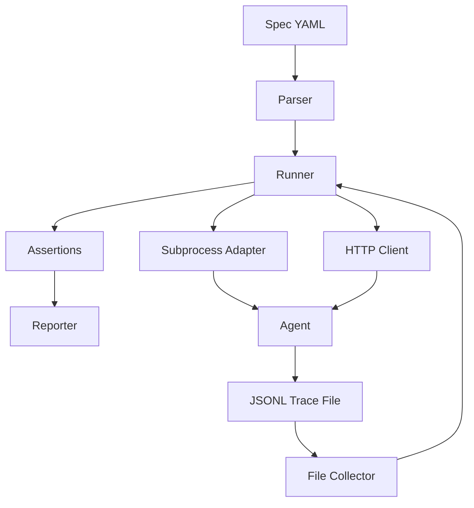

# Architecture Overview

Highbar is a behavior testing framework for AI agents. It tests the **agent** -- not the LLM -- by defining expected behaviors in YAML specs, instrumenting tool calls via a Python decorator, and running assertions against collected traces.

## Component Diagram



## Components

### Parser

**Module:** `highbar.engine.parser`

Reads `.highbar.yaml` spec files, validates their structure, and produces strongly-typed domain models (`Spec`, `Suite`, `Test`, `Expect`, etc.). The parser is the entry point for all test execution -- every run starts by parsing a spec.

### TestRunner

**Module:** `highbar.engine.runner`

The central orchestrator. The `TestRunner` coordinates the entire test flow:

1. Starts the agent via the `AgentAdapter`.
2. Iterates through suites and tests.
3. Records trace checkpoints before each test.
4. Resolves <code v-pre>{{previous.*}}</code> templates for multi-turn tests.
5. Sends HTTP triggers via the `HTTPClient`.
6. Waits `settle_time` for the agent to finish writing traces.
7. Collects traces via the `TraceCollector`.
8. Evaluates all assertions against the collected data.
9. Reports results via the `Reporter`.
10. Stops the agent when done.

### Assertions

**Module:** `highbar.assertions.*`

Two built-in assertion implementations:

| Class | Responsibility |
|-------|---------------|
| `FunctionCallsAssertion` | Validates tool invocations -- function name, params (subset match), result (subset match). Also handles empty-list guardrail assertions where no tools should be called. |
| `ResponseAssertion` | Validates the agent's text response -- `contains` (substring), `not_contains` (absent substring), `matches` (regex via `re.search`). |

Both implement the `Assertion` protocol, making it straightforward to add custom assertion types.

### Reporter

**Module:** `highbar.reporters.terminal`

The `TerminalReporter` formats test results for the terminal using the `rich` library. It displays:

- Suite headers.
- Pass/fail status with timing for each test.
- Error details for failed assertions.
- A summary line with total/passed/failed counts and overall duration.

### SubprocessAdapter

**Module:** `highbar.adapters.subprocess_adapter`

Manages the agent process lifecycle:

- **Start**: Launches the agent as a subprocess with `HIGHBAR_TRACES_URL` injected into the environment. If a health check URL is configured, polls it every 200ms until it returns HTTP 200 or the startup timeout expires.
- **Stop**: Sends `SIGTERM` to the process. If it does not exit within 5 seconds, sends `SIGKILL`.

### FileTraceCollector

**Module:** `highbar.adapters.file_collector`

Reads trace boxes from the JSONL trace file:

- **Checkpoint**: Returns the current line count in the file.
- **Collect**: Reads all lines added after the checkpoint, parses each as JSON, and returns a list of `Trace` domain objects.

This checkpoint-based approach means Highbar does not need to inject request IDs into the agent. Each test simply reads the traces that appeared during its execution window.

### HTTPClient

**Module:** `highbar.adapters.http_client`

Sends POST requests to the agent's HTTP endpoint with a JSON body of `{"message": trigger}`. Parses the response JSON, checking common field names (`response`, `message`, `content`, `text`, `reply`) to extract the response text.

## Data Flow

```
1. Parse YAML spec → domain models (Spec, Suite, Test, Expect)
2. Create temp JSONL file
3. Start agent subprocess (with HIGHBAR_TRACES_URL)
4. For each test:
   a. Checkpoint trace file (record line count)
   b. POST trigger to agent endpoint
   c. Agent processes request, calls @hb.tool functions
   d. @hb.tool decorator writes trace boxes to JSONL
   e. Agent returns HTTP response
   f. Wait settle_time
   g. Read new trace lines since checkpoint
   h. Run assertions against traces + response
   i. Report result
5. Stop agent subprocess
6. Report summary
```

## Key Design Principles

- **Test the agent, not the LLM.** The language model is an implementation detail. Highbar validates that the agent calls the right tools with the right arguments and produces appropriate responses.
- **Minimal instrumentation.** The `@hb.tool` decorator is the only change required in agent code. No middleware, no mocks, no test doubles.
- **Protocol-based extension.** All major components (assertions, reporters, adapters, collectors) are defined as `Protocol` classes. Swap implementations without touching the runner.
